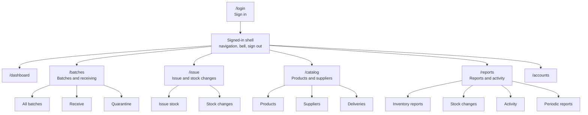
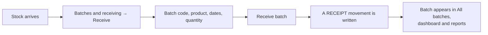
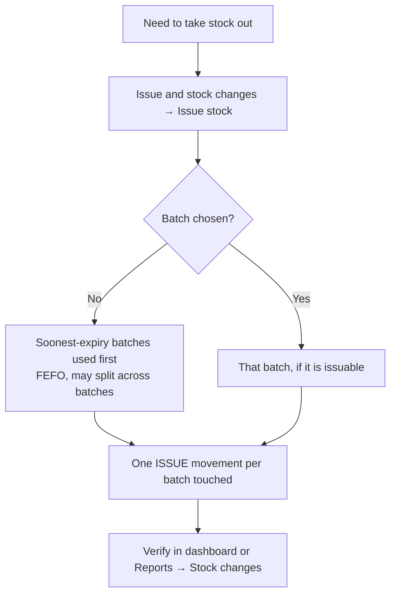
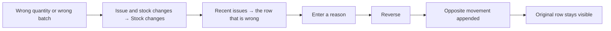
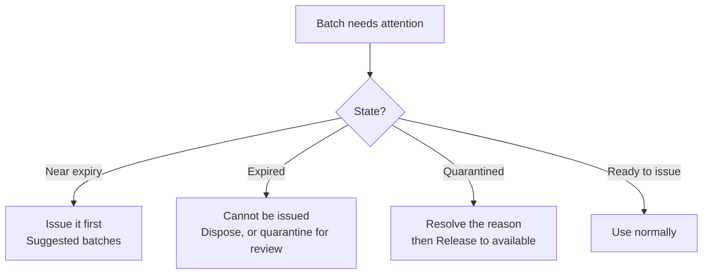
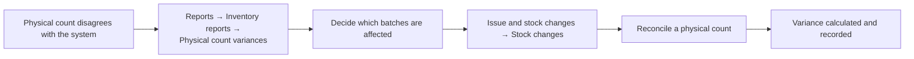

# Provi Beans: how to use it, screen by screen

This is the guided tour. For every screen it answers four questions:

1. **Why does it exist?** — what job it does that no other screen does.
2. **Who can use it?** — which role may open it, and which may change things there.
3. **How do I use it?** — the controls in the order you would actually touch them.
4. **What do I do next?** — where the result shows up, and what usually needs attention afterwards.

Read this first if you are learning the application. Then go deeper with:

| Document | What it adds |
|---|---|
| [`../USER_GUIDE.md`](../USER_GUIDE.md) | The shorter screen-by-screen reference |
| [`system-flow.md`](system-flow.md) | How the ledger, derivations, and every flow work internally |
| [`inventory-reporting.md`](inventory-reporting.md) | Report definitions, filters, exports, verification |
| [`data-protection.md`](data-protection.md) | Sign-in, roles, validation, sessions, backups, audit |

---

## 1. The one idea that explains every screen

**Provi Beans never stores a stock total. It stores a history of movements, and derives every number from that history when a screen loads.**

That single decision explains almost everything that looks unusual:

- You never "edit the stock level". You record an event — received, issued, damaged, counted — and the level follows.
- A mistake is fixed by appending a **reversal**, never by deleting or editing the original row. The history stays readable.
- Batches, not products, carry the dates. Product-level numbers are rolled up from batch-level numbers.
- Numbers can change without anyone touching the app: a batch crosses its expiry date, so it stops being issuable, so available drops, so an alert appears.
- Alerts and notifications are recomputed rather than stored, so nothing needs dismissing to "clear" a condition. Fix the cause and the alert disappears on the next load.

Everything below is a consequence of that idea.

---

## 2. First five minutes

1. **Sign in** at `/login`. The administrator email is prefilled; the demo password is `ProviBeans2026`. Press **Sign in**.
2. **Land on the dashboard** and read it in this order: the four summary figures, then **Alerts** (anything wrong right now?), then **Expiring soon** (what should move first?), then **Blocked batches** (what can I not promise?).
3. **Do one real task.** Open **Issue & stock changes → Issue stock**, pick a product, set Quantity to `1`, leave Batch blank, and press **Issue stock**.
4. **Check what happened.** Go to **Reports & activity → Stock changes** (administrator or owner) or scroll the dashboard's **Recent stock changes** table. Your issue is there, with quantity, reason, and reference.
5. **Sign out** from the header. If you leave the app idle for 30 minutes it signs you out anyway.

A useful habit: after any action, glance at the history row it produced. If the row looks wrong, the action was wrong, and a reversal is the fix.

### If you already know what you want

| I want to… | Go to |
|---|---|
| See whether anything is wrong | `/dashboard` → **Alerts** |
| Record stock arriving | `/batches/receive` |
| Take stock out for an order | `/issue` |
| Reserve stock for a future order | `/issue/movements` → *Reserve for an order* |
| Fix a quantity I keyed wrong | `/issue/movements` → **Recent issues** → **Reverse** |
| Pull suspect stock without writing it off | `/batches/quarantine` |
| Add a product or a supplier | `/catalog` |
| See everything that moved this month | `/reports/movements` |
| Prove who changed what | `/reports/activity` |
| Give a colleague a login | `/accounts` |

---

## 3. Who can do what

| Capability | Administrator | Owner / manager | Inventory staff |
|---|---|---|---|
| View dashboard, alerts, batches, notifications | Yes | Yes | Yes |
| Receive batches | Yes | Yes | Yes |
| Quarantine and release batches | Yes | Yes | Yes |
| Issue stock | Yes | Yes | Yes |
| Record stock changes (reserve, return, damage, dispose, adjust, count) | Yes | Yes | Yes |
| Reverse a movement | Yes | Yes | Yes |
| View products, suppliers, deliveries | Yes | Yes | Yes — read-only |
| Add/edit products, suppliers, deliveries | Yes | Yes | No |
| Open reports, exports, activity, periods | Yes | Yes | No — hidden in navigation |
| Manage accounts | Yes | Yes | No |
| Backup and restore | Yes | Yes | No |

Two details worth knowing:

- The **Reports & activity** and **Accounts** items do not appear in the navigation for inventory staff. The pages themselves also refuse the visit.
- Day-to-day stock operations are open to every signed-in role. That is a demonstration choice, not a real-world permission model; see [§10](#10-limits-of-this-demo).

---

## 4. The map

| Route | Title on screen | Tabs |
|---|---|---|
| `/login` | Stock control | — |
| `/dashboard` | Dashboard | — |
| `/batches` | Batches & receiving | All batches · Receive · Quarantine |
| `/issue` | Issue & stock changes | Issue stock · Stock changes |
| `/catalog` | Products & suppliers | Products · Suppliers · Deliveries |
| `/reports` | Reports & activity | Inventory reports · Stock changes · Activity · Periodic reports |
| `/notifications` | Notifications | — |
| `/accounts` | Accounts | — |

---

## 5. The five flows you will repeat

### 5.1 Receive a delivery

1. Open **Batches & receiving → Receive**.
2. Fill the form: **Batch code** (unique across all stock), **Product**, **Delivery** (optional link to a supplier delivery), **Quantity**, **Received** (defaults to today), and the date fields — **Roasted**, **Packed**, **Best before**, **Expires**. Add **Notes** if something about this delivery should be remembered.
3. Press **Receive batch**.
4. The batch now exists as its own record with its own dates, and a receipt movement is in the history.

**Why the dates matter more than anything else on this form.** The application uses one "use-by" date per batch, chosen in this order: **Expires**, then **Best before**, then the received date. That date decides days-to-expiry, the near-expiry warning, the **Expired** state, and the order in which batches are suggested for issuing. Leave **Expires** blank and the received date silently becomes the use-by date, which will look like stock that expired today.

**What "done" looks like:** the batch is visible in **All batches** with state **Ready to issue** and the expected number of available units.

**Next:** link the delivery if you skipped it; otherwise nothing — the batch is now in the issuing queue.

### 5.2 Issue stock

1. Open **Issue & stock changes → Issue stock**.
2. Choose the **Product**, the **Quantity**, and optionally a **Batch**.
3. Add a **Reference** (sales order or customer reference) and a **Reason** if the issue is not routine.
4. Press **Issue stock**.

**Leaving Batch blank is the recommended default.** The application then draws from the batches that expire soonest — first-expired, first-out. Expired and quarantined batches are excluded automatically and can never be issued.

**Issues can span batches.** If a product needs 200 units and its soonest batch has only 124 available, the issue takes 124 from that batch and 76 from the next one, writing two movements. Both appear in the history, so a single order is always traceable.

**Before you issue, check the panel underneath.** **Suggested batches** lists, per product, the batch to use first, its use-by date, how many batches will be in play, and the total units ready to issue. That is the answer to "which batch should I pick?" — and the reason leaving the field blank is usually right.

**What "done" looks like:** the quantity in **Ready to issue** dropped, and an ISSUE row exists with your reference.

**Next:** confirm in **Reports & activity → Stock changes**, or reserve stock instead of issuing it if the order ships later.

### 5.3 Correct a mistake

1. Open **Issue & stock changes → Stock changes**.
2. In **Recent issues**, find the row that is wrong.
3. Type the reason in that row's field — "Keyed against the wrong batch", for example — and press **Reverse**.

**Why not just edit the row?** Because the history is the source of truth, and a silent edit would make every earlier report a lie. A reversal adds the opposite movement, so the mistake and its correction are both visible. The net effect is what you wanted; the audit trail is intact.

**When a reversal is refused.** Reversing an issue that has already been reserved against can be blocked, because the correction would have to release reserved stock from a batch that is now expired or on hold. The form says so. The fix is to release or re-reserve the reservation first, then reverse.

**Next:** check that the quantity is where you expect it, then continue. Do not try to "reverse the reversal" — if the correction itself was wrong, reverse the new movement with a new reason.

### 5.4 Handle expiring and held stock

- **Near expiry.** The dashboard's **Expiring soon** panel lists ready-to-issue batches with the fewest days left. Issue those first; the suggested-batch logic already prefers them.
- **Expired.** An expired batch keeps its units on the books but shows **Available 0** and cannot be issued. Decide: quarantine it while someone investigates, or dispose of the stock.
- **Quarantined.** Open **Batches & receiving → Quarantine**. Each held batch shows its reason and a **Release to available** control. Quarantine never changes the in-stock figure — it only stops the stock being issued or reserved.
- **Already blocked on the dashboard.** The **Blocked batches** panel is the short list of expired and quarantined batches, with in-stock and available side by side. In-stock without available is the signature of blocked stock.

**Next:** after releasing or disposing, reload or navigate; the dashboard's **Blocked batches** and **Alerts** panels recompute and drop the row.

### 5.5 Investigate a count variance

1. Open **Reports & activity → Inventory reports** and read **Physical count variances**.
2. Open **Issue & stock changes → Stock changes** and choose **Reconcile a physical count** as the stock change.
3. Pick the batch and enter the **Counted quantity** — what you physically counted, not the difference. The variance is calculated for you and recorded with your reason.
4. Verify the result in the history.

Do not use **Manual adjustment** for a count. Adjustment is for deliberate increases or decreases with a reason; a count is a statement of observed reality, and the report treats the two differently.

---

## 6. Screen by screen

### 6.1 Sign in — `/login`

**Why it exists.** Actions are attributed to a person, and the role decides which screens exist at all. The demo therefore needs an identity before anything else.

**Who.** Anyone with an account. The three demo accounts all use `ProviBeans2026`.

**What you see.** A card headed **Provi Beans** / **Stock control**, with **Email** prefilled as `admin@provibeans.ph`, a **Password** field, and **Sign in**.

**How to use it.** Enter the password, press **Sign in**. A successful sign-in replaces the route with `/dashboard`. A wrong email and a wrong password produce the same generic message, deliberately, so the form never confirms which half was wrong.

**What to do next.** Read the dashboard in the order described in [§2](#2-first-five-minutes).

**Notes.** An idle session ends after 30 minutes and returns you here with "You have been signed out." There is no password reset; an administrator creates accounts with a password, or leaves it blank to use the shared demo password.

### 6.2 Dashboard — `/dashboard`

**Why it exists.** It answers "is anything wrong right now?" before "how much stock do we have?" — operational exceptions first, then stock. Every figure is derived from the history rather than stored.

**Who.** Every signed-in role.

**What you see.**

- Four figures: **Inventory value** (in-stock units at list price), **Available** (ready to issue right now), **Reserved** (committed, not yet released), **Open alerts** (with a count of critical ones, or "Nothing critical").
- **Alerts** — recomputed on every load, resolved automatically when the condition clears. Each row is a link that opens the screen able to fix it, with the relevant row highlighted.
- **Stock by product** — SKU, product, in stock, reserved, available, and a state badge. The small line under each name is the batch count.
- **Expiring soon** — the five ready-to-issue batches with the fewest days left.
- **Blocked batches** — expired or quarantined batches, with in-stock and available.
- **Recent stock changes** — the last twelve movements, with a link to the full history.

**How to use it.** Scan the figures, then the alerts. Click an alert rather than navigating manually: the link carries you to the right tab with the row focused. Use **Expiring soon** to choose what to issue first, and **Blocked batches** before promising stock to anyone.

**What to do next.** Each alert names the problem; the fix is almost always one of: receive more stock, issue the near-expiry batch, quarantine or dispose an expired batch, or release a batch that has been cleared.

**Notes.** Alerts are live; the notifications inbox is seeded demonstration data and can disagree with them. See [§8](#8-looks-wrong-but-is-right).

### 6.3 All batches — `/batches`

**Why it exists.** Batch-level truth. Products have totals, but only batches have dates, holds, and availability — and only batches can be issued from.

**Who.** Every signed-in role.

**What you see.** A table of every batch: **Batch**, **Product** (SKU with the name underneath), **Use-by date**, **Days**, **In stock**, **Reserved**, **Available**, **State**. State is one of **Expired**, **Quarantine**, **Near expiry**, **Ready to issue**.

**How to use it.** Sort by eye using **Days**: the smallest numbers are the batches to move first. A batch with in-stock but no available is blocked by expiry or a hold.

**What to do next.** Expired → decide dispose or quarantine. Quarantined → the Quarantine tab. Near expiry → issue it first. Nothing outstanding → the batch is in the normal queue.

### 6.4 Receive — `/batches/receive`

**Why it exists.** Stock enters the system only by being received. Receiving records an arrival as a batch instead of editing a stored total, which keeps the history as the single source of truth.

**Who.** Every signed-in role.

**What you see.** A form: **Batch code** (unique across all stock), **Product**, **Delivery** (optional), **Quantity**, **Received** (defaults to today), **Roasted**, **Packed**, **Best before**, **Expires**, **Notes**, and the **Receive batch** button.

**How to use it.** Complete the code, product, quantity, and at least the date that governs expiry. Link a delivery when the batch came from a recorded supplier delivery; the link is what makes provenance traceable later.

**What to do next.** Confirm the new batch in **All batches**, then check whether it cleared a **Reorder** or **Low stock** badge on the dashboard.

**Notes.** A duplicate batch code is rejected. Quantity must be a positive whole number. A receipt is a `RECEIPT` movement; it cannot be edited afterwards, only reversed.

### 6.5 Quarantine — `/batches/quarantine`

**Why it exists.** Some stock should not be issued but should not be written off either — damaged packaging, a supplier question, a suspected date problem. Quarantine holds stock in place: still on the books, still counted, unavailable.

**Who.** Every signed-in role.

**What you see.** Two panels. **Quarantine** lists held batches with their reason and a **Release to available** control. **Hold a batch** lists active batches, each with a reason field and a **Quarantine** button.

**How to use it.** To hold: type the reason and press **Quarantine**. The reason is required. To release: press **Release to available** on the held batch — no reason is needed because the hold record already exists.

**What to do next.** If the stock is cleared, release it and it re-enters the issuing queue. If it is not salvageable, record a **Dispose** stock change instead of leaving it held forever.

**Notes.** Quarantining does not change in-stock. It changes available, to zero. That is why the dashboard shows both figures side by side.

### 6.6 Issue stock — `/issue`

**Why it exists.** Stock leaves against a batch, and the application should choose the batch that expires soonest unless a person has a reason to override it.

**Who.** Every signed-in role.

**What you see.** **Issue stock** with **Product**, **Quantity**, **Batch** (defaulting to "Soonest expiry first — recommended"), **Reference**, **Reason**, and the **Issue stock** button. Below it, **Suggested batches**: for each product, the batch to issue first, its use-by date, days left, how many batches are in play, and total ready to issue.

**How to use it.** Choose the product and quantity; leave the batch blank unless the order requires a specific one. Add a reference for anything customer-facing. Press **Issue stock**.

**What to do next.** Verify in the history. If the order is not shipping yet, reserve it instead: **Stock changes → Reserve for an order**.

**Notes.** The batch dropdown only contains batches that are issuable and have available stock, so blocked batches cannot be selected by accident. If available is lower than the quantity, the form refuses rather than going negative.

### 6.7 Stock changes — `/issue/movements`

**Why it exists.** Not every stock event is a receipt or an issue. Reservations, returns, damage, disposal, adjustments, physical counts, and reversals all live here.

**Who.** Every signed-in role.

**What you see.** **Record a stock change** with **Batch**, **Stock change** (reserve, release a reservation, cancel a reservation, return stock in, record damage, dispose stock, manual adjustment, reconcile a physical count), an **Adjustment direction** field that appears only for manual adjustments, **Quantity** (or **Counted quantity** for a count), **Reason**, **Reference**, and **Record stock change**. Below it, **Recent issues** — the eight most recent issues, each with a **Reverse** control and a reason field.

**How to use it.**

- **Reserve** for an order that has not shipped: available falls, in-stock does not.
- **Release** a reservation when the hold is no longer needed — the order shipped, or the stock was reallocated. **Cancel** a reservation when the order itself will not happen. Both free the reserved units without changing in-stock.
- **Return stock in** for a customer return that goes back on the shelf.
- **Record damage** or **Dispose stock** for stock that is leaving for good.
- **Manual adjustment** with **Increase stock** or **Decrease stock** for a deliberate correction.
- **Reconcile a physical count**: enter what you counted; the variance is calculated.
- **Reverse** from the recent-issues list to undo an issue.

**What to do next.** Check the result in **Reports → Stock changes**; if the change was a count, check **Reports → Inventory reports → Physical count variances**.

**Notes.** A reason is required for a stock change and for a reversal. Nothing is ever deleted; every correction is another row.

### 6.8 Products — `/catalog`

**Why it exists.** Master data: the SKU, the name, the price, and the thresholds that turn availability into a reorder decision.

**Who.** Everyone may read. Only administrators and owners may add, deactivate, or reactivate. Staff see the page with a read-only notice.

**What you see.** A table of **SKU**, **Name**, **Origin**, **Blend**, **Size**, **Price**, **Low / reorder**, and **Batches**, plus a **State** column for roles that may edit. Inactive products keep an **Inactive** badge. Below, **Add a product** with the note that the SKU must be unique.

**How to use it.** Read the thresholds as "low stock level / reorder point". Set them deliberately: they drive the **Low stock** and **Reorder** badges and the alerts that follow. Deactivating a product stops it being received or issued but keeps its batches and history.

**What to do next.** New products need at least one received batch before they show any stock. Threshold values are worth reviewing after a few weeks of real issuing.

**Notes.** Deactivating is not deleting. There is no delete, because deleting would orphan the history.

### 6.9 Suppliers — `/catalog/suppliers`

**Why it exists.** Provenance. A batch that cannot be traced to a supplier cannot be recalled precisely.

**Who.** Everyone may read; only administrators and owners may add.

**What you see.** A suppliers table and an **Add a supplier** form.

**How to use it.** Add the supplier before recording its first delivery, so deliveries can reference it.

**What to do next.** Record the delivery under **Deliveries**, then receive the batch and link it.

### 6.10 Deliveries — `/catalog/deliveries`

**Why it exists.** A delivery is the paperwork between a supplier and one or more batches. It is the middle link in supplier → delivery → batch → movement.

**Who.** Everyone may read; only administrators and owners may record.

**What you see.** A deliveries table and a **Record a delivery** form.

**How to use it.** Record the delivery when it arrives, then receive the batches with **Delivery** set. The batch's **Delivery** field is what carries the provenance.

**What to do next.** Receive the stock. An unreceived delivery changes no stock figures — correctly, because nothing has entered the building yet in the system's terms.

### 6.11 Inventory reports — `/reports`

**Why it exists.** The same ledger, read back in the shapes people ask for: stock by product, stock by batch, reorder, expiry, damage, and count variance.

**Who.** Administrators and owners. Staff do not see the navigation item and the page refuses the visit.

**What you see.** Six panels: **Stock by product**, **Stock by batch**, **Reorder list**, **Near-expiry and expired lots**, **Damaged and disposed stock**, **Physical count variances**.

**How to use it.** Start with **Reorder list** when planning purchases, **Near-expiry and expired lots** when planning usage or disposal, and **Physical count variances** when the shelf disagrees with the system.

**What to do next.** Each panel is a decision prompt: reorder → receive; near expiry → issue first; variance → record a count.

**Notes.** The batch panel reads the same batch views as **All batches**, so the two can never disagree.

### 6.12 Stock changes report — `/reports/movements`

**Why it exists.** The full, filterable history. If you need to know what happened, this is the screen that answers it.

**Who.** Administrators and owners.

**What you see.** **Stock history** with filters and a result count of the form "N of M entries", plus CSV export.

**How to use it.** Filter by type, batch, or date range, then export if the answer has to leave the application. The export is generated in the browser.

**What to do next.** Use it to verify an action, investigate a discrepancy, or hand a period to an accountant.

### 6.13 Activity — `/reports/activity`

**Why it exists.** Stock history answers "what happened to stock". Activity answers "who did what" — sign-ins, sign-outs, account changes, catalogue changes, exports, restores.

**Who.** Administrators and owners.

**What you see.** The audit trail with a period filter.

**How to use it.** When a figure surprises you, read the stock history first, then activity to see who caused it.

**What to do next.** If an action was wrong, correct it in the module that owns it — do not attempt to edit the audit trail, which is append-only by design.

### 6.14 Periodic reports — `/reports/periods`

**Why it exists.** A period view: the stock change summary and the per-product breakdown for a chosen week or month.

**Who.** Administrators and owners.

**What you see.** A period selector, a period heading, **Stock change summary**, **By product**, and exports.

**How to use it.** Pick the period, read the summary, export the underlying figures.

**What to do next.** Compare consecutive periods. A jump in disposals or count variances is usually the first sign of a process problem.

### 6.15 Notifications — `/notifications`

**Why it exists.** An inbox for things worth acting on, reachable from the bell in the header with an unread count.

**Who.** Every signed-in role.

**What you see.** A list of notifications with a severity badge, a relative time, a title, a message, an **Open …** link where a destination exists, and **Mark as read** per item plus **Mark all read**.

**How to use it.** Open the linked screen rather than acting from memory; the link focuses the relevant row. Marking as read is local to the browser.

**What to do next.** The destination screen tells you what the fix is. There is nothing to dismiss or acknowledge beyond reading.

**Notes.** These entries are seeded demonstration fixtures, not live alerts. The dashboard's **Alerts** panel is the computed truth. See [§8](#8-looks-wrong-but-is-right).

### 6.16 Accounts — `/accounts`

**Why it exists.** The demo needs identities, and a departing colleague should stop being able to sign in without their history disappearing.

**Who.** Administrators and owners. Staff see "Only an administrator or the owner may manage accounts."

**What you see.** A table of **Name**, **Email**, **Role**, **State**, and **Action**, with a **You** badge and **Signed in** where the row is your own account. Below, **Add an account**, then the backup panel.

**How to use it.** Create the account with a name, email, role, and password — leave the password blank to use `ProviBeans2026`. Choose the role deliberately: it decides reports, catalogue editing, and accounts access. Deactivate a leaver rather than deleting them; the account is kept and can be switched back on.

**What to do next.** Tell the new user their password and that all three demo passwords are shared. If you deactivate someone, their existing session ends on the next idle check or when they sign out.

**Notes.** You cannot deactivate yourself; your own row shows **Signed in** instead of a control. New accounts can sign in immediately — there is no invitation step.

**Backup panel.** Download writes a JSON snapshot; restore replaces the application state from such a file. Backups contain the demo's plain-text passwords and should be treated as demonstration artefacts. CSV exports are separate and are produced per report.

### 6.17 The header

**Why it exists.** Orientation and exits: which screen you are on, whether anything is unread, and how to sign out.

**What you see.** The application navigation, a notifications bell with unread count, a theme control, and **Sign out**.

**What to do next.** Use the bell for seeded notifications and the dashboard for live exceptions.

---

## 7. Reading the badges and numbers

### Product state (dashboard, products)

| Badge | Meaning | What to do |
|---|---|---|
| **Above reorder point** | Available is above the reorder point | Nothing |
| **Reorder** | Available is at or below the reorder point but above the low-stock level | Plan a purchase |
| **Low stock** | Available is at or below the low-stock level | Receive urgently |
| **Expired hold** | The product has expired stock on hand | Dispose of it or quarantine while investigating — buying more will not fix the badge |

The last one takes precedence deliberately. An expired lot holding stock is a disposal problem, not a purchasing problem; calling it "low" would send someone shopping while unsellable stock sits on the shelf.

### Batch state (All batches, blocked batches)

| Badge | Meaning | What to do |
|---|---|---|
| **Ready to issue** | Active, not expired, not held | Use it, soonest expiry first |
| **Near expiry** | Inside the near-expiry window | Issue it ahead of later batches |
| **Quarantine** | Held; in stock but unavailable | Resolve the reason, then **Release to available** |
| **Expired** | Past its use-by date; available is zero | Dispose, or quarantine while reviewing |

### The three quantities

| Column | Meaning |
|---|---|
| **In stock** | Physically recorded in the batch |
| **Reserved** | Committed to an order, not yet released |
| **Available** | In stock minus reserved, and zero when the batch is expired or held |

Available is the number to trust when deciding what can be promised. In stock is the number to trust when counting what exists.

### The eight stock changes

| Stock change | Effect | Use it when |
|---|---|---|
| Reserve for an order | Reserved up, available down | An order exists but has not shipped |
| Release a reservation | Reserved down, available up | The order ships, or the hold is no longer needed |
| Cancel a reservation | Reserved down, available up | The order will not happen |
| Return stock in | In stock up, available up | A customer returns saleable stock |
| Record damage | In stock down | Stock is spoiled but the reason is damage |
| Dispose stock | In stock down | Stock leaves for good |
| Manual adjustment | In stock up or down by direction | A deliberate correction with a reason |
| Reconcile a physical count | In stock set to the counted quantity | The shelf and the system disagree |

---

## 8. "Looks wrong, but is right"

1. **Available is zero while in-stock is not.** The batch is expired or quarantined. Both states remove it from issuing without changing what physically exists.
2. **A quarantine did not change in-stock.** Correct. A hold changes availability, not existence.
3. **A reservation lowered available without lowering stock.** Correct. Reserved stock still exists; it is simply promised.
4. **A reversal created a second row instead of removing the first.** By design. The history is append-only.
5. **The dashboard shows only twelve recent changes.** It is a preview; the full history is under **Reports → Stock changes**.
6. **Notifications mention low stock that the dashboard does not show.** Notifications are seeded fixtures; dashboard alerts are computed. Trust the dashboard.
7. **A deactivated product still appears with batches.** Deactivation stops receiving and issuing; it does not erase history.
8. **A count of zero is accepted.** A count of zero is a legitimate observation — it means the batch is empty, and the variance is recorded.
9. **An alert disappeared on its own.** Alerts are recomputed. The condition cleared; nothing was dismissed.
10. **The days figure dropped without anyone acting.** Time passed. Expiry is derived from the date, not stored as a status.

---

## 9. When the application refuses

| Message or behaviour | Cause | Fix |
|---|---|---|
| "That email and password combination was not recognised." | Wrong credentials, or account deactivated | Check the demo password, or ask an administrator to reactivate |
| Batch code already exists | Batch codes are unique | Choose a different code |
| Quantity rejected | Zero, negative, or more than available | Use a whole positive number within what is available |
| Batch cannot be issued | Expired or quarantined | Release it, or use another batch |
| Reversal refused because it would reserve stock from an expired or quarantined batch | The original issue has a reservation attached to a batch that is now blocked | Release or re-reserve the reservation, then reverse |
| Accounts page says only an administrator or owner may manage accounts | Role has no access | Sign in with an administrator or owner account |
| Reports page refuses the visit | Inventory staff have no report access | Sign in with an administrator or owner account |
| Sign-in page with no message | A protected page was opened without a session | Sign in again — only an idle sign-out shows the signed-out notice |

Validation messages appear next to the field that failed, and the form keeps what you typed. Nothing is half-saved: a rejected action writes no movement.

---

## 10. Limits of this demo

- All state is browser-local. It is not shared between people, browsers, or devices.
- Clearing site data resets changes back to the seeded demonstration data.
- Passwords are stored in plain text in browser storage, and role checks are a user-interface demonstration, not a security boundary.
- The 30-minute idle sign-out is a convenience lock, not a security control.
- Backups are JSON files written and read in the browser and contain those plain-text passwords.
- Notifications are seeded fixtures, not a live feed.
- Exports are generated in the browser; there is no server to email or schedule them.
- Product photography is thumbnail resolution.
- There is no database, no API, and no external service — deliberately, as described in [`../AGENTS.md`](../AGENTS.md).

---

## 11. Where to read next

| Question | Document |
|---|---|
| How does the ledger actually compute this? | [`system-flow.md`](system-flow.md) |
| What exactly does each report include? | [`inventory-reporting.md`](inventory-reporting.md) |
| How do sessions, roles, and backups work? | [`data-protection.md`](data-protection.md) |
| Short reference for a specific screen | [`../USER_GUIDE.md`](../USER_GUIDE.md) |
| How to run and verify the application | [`../README.md`](../README.md) |
